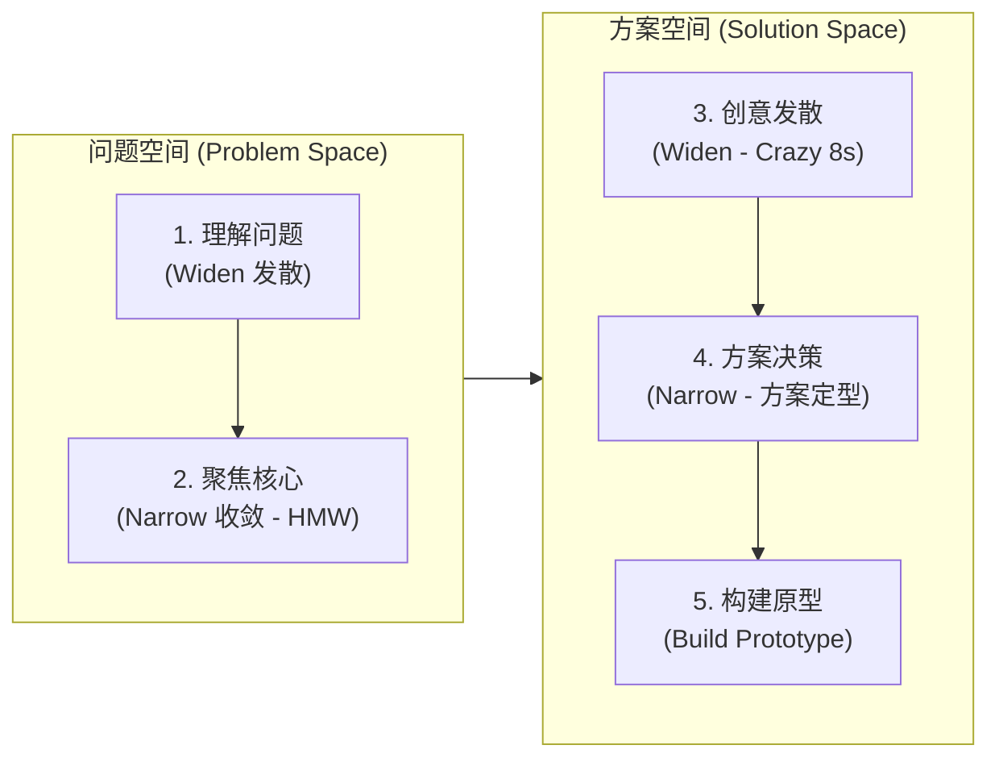
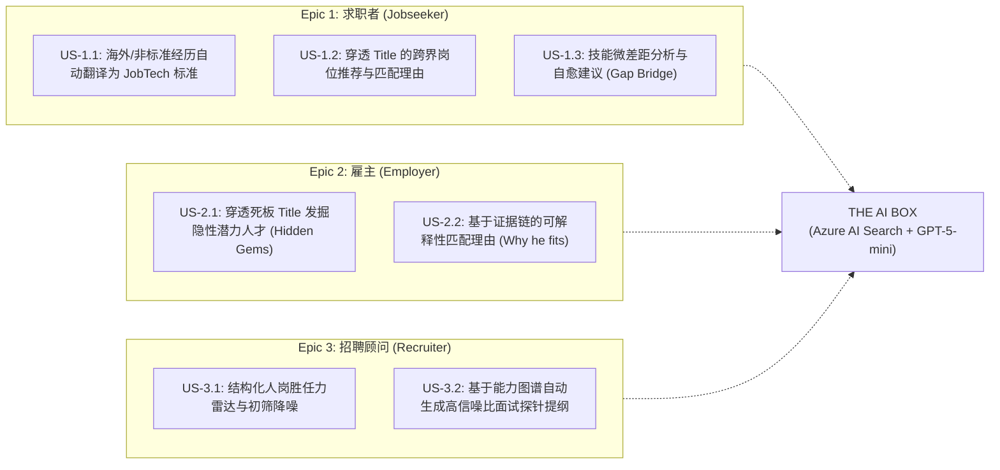

# 🚀 AISpire Hackathon: AI-Powered Hidden Talent Tool
> **Hackathon Command Center & Problem Brainstorm Blueprint**  
> **主办方背景**: Avanade / Accenture / Microsoft  
> **赛题名称**: **Build an AI-powered Hidden Talent Tool that bridges the gap between talent and jobs**  
> **目标区域**: 瑞典市场 (Sweden Central / JobTech Taxonomy / Swedish Labour Market)

---

## 一、 核心挑战与赛题目标 (The Challenge Statement)

### 1. 核心愿景 (Core Vision)
> **“Every day the right person and the right job pass each other by — not because the competence is missing, but because no one translates.”**  
> *(每天都有合适的人与合适的岗位擦肩而过——不是因为缺少胜任力，而是因为没有人去进行准确的翻译与映射。)*

成千上万的求职者具备岗位所需的胜任力，但他们的表达方式与雇主（招聘系统）的搜索方式存在巨大的“语言与语义鸿沟”。  
**本次黑客松挑战**：基于 **Azure** 构建一个 AI 驱动的 **“Hidden Talent Tool（隐性人才发掘工具）”**，挖掘被传统简历过滤机制掩盖的潜在胜任力，弥合求职者与劳动力市场之间的断层。

### 2. 团队探索三大支柱 (Teams Will Explore)
1. **胜任力提炼与翻译 (Extract & Translate Competencies)**：如何将非结构化、个性化、甚至非本土背景的经历，自动提取并翻译为标准化的行业技能图谱。
2. **AI 智能匹配与拟合 (Match Candidate Profiles to Open Roles using AI)**：如何不仅基于关键词匹配，而是基于真实胜任力、潜力和可迁移技能进行语义与向量匹配。
3. **可解释性与信任机制 (Trustworthy, Useful Data, Logic & Interface)**：什么样的交互界面、数据逻辑和匹配解释（Explainability），能让求职者与雇主双方都建立真正的信任。

### 3. 黑客松四项基本原则 (Hackathon Principles)
* 🎯 **Start with the Problem（从问题出发）**：在定义解决方案前，先彻底理解真实用户与未被满足的核心痛点。
* 🚀 **Think Big（宏大思考）**：不要被现有的传统招聘系统约束限制，去构想面向未来的解决方案。
* 🔍 **Challenge the Obvious（挑战既定常识）**：审视当今招聘与匹配机制的深层弊端（如学历偏见、关键词过滤、海外经历歧视）。
* 🧭 **Explore Before You Decide（多路探索，审慎收敛）**：在动手编码前，至少对比多种方案，不要急于执行第一个冒出来的念头。

### 4. 架构本质思考：连接三方用户的 "AI Box" 智能中枢 (The Core AI Box Model)

从最高维度的第一性原理（First Principles）来看，本次黑客松要做的核心产品，**本质上就是一个连接与赋能三方核心角色的“AI Box（智能匹配与翻译中枢）”**：

```
       [ 👤 1. Job Seeker (求职者) ]          [ 🏢 2. Employer (用人雇主) ]
       • 痛点: 拥有胜任力但被关键词秒拒      • 痛点: 73%人才荒，招不到对口人
       • 输入: 非标准简历 / 海外经历描述      • 输入: 岗位需求 (JD) / 真实业务痛点
                      │                                      │
                      ▼                                      ▼
      ┌──────────────────────────────────────────────────────────────┐
      │                   THE "AI BOX" (智能中枢)                     │
      │                                                              │
      │   ① 胜任力解构与翻译: 将个性化经历 ──> JobTech 官方标准拓扑     │
      │   ② 隐性潜力向量匹配: 穿透 Job Title，基于真实底层能力匹配     │
      │   ③ 双向可解释性解释: 解释“为什么匹配”与“技能差距弥合路径”    │
      └──────────────────────────────────────────────────────────────┘
                                     ▲
                                     │
                     [ 💼 3. Recruiter (招聘顾问 / 猎头) ]
                     • 痛点: 简历初筛噪音大、缺乏跨领域评估工具
                     • 输出消费: 获得高置信度的人岗匹配雷达与面试洞察
```

* **AI Box 的核心本质**：
  * 它不是传统的死板关键词过滤器（Keyword Filter）；
  * 它是一个**双向语义翻译器（Two-way Semantic Translator）** + **隐性价值发现引擎（Hidden Potential Detective）**；
  * **至于底层是用 Azure AI Search 混合检索、GPT-5-mini 链式推理还是 Cosmos DB 存储，都是服务于这个“AI Box”的工程实现手段**。首先抓住这个宏观三方闭环，整个黑客松的原型设计就不会跑偏！

---

## 二、 痛点数据与背景事实 (Why This Challenge Matters)

本次黑客松提供了强有力的瑞典及全球劳动力市场研究数据支撑（可直接用于 Demo Pitch PPT）：

| 维度 | 关键现实痛点与权威数据 | 核心根因与启示 |
| :--- | :--- | :--- |
| **求职者端<br>(Jobseekers)** | • **58%** 的求职者表示：即使自身完全符合岗位资质，依然直接被无情拒信拒之门外 *(Univ of Phoenix 2026)*<br>• 求职者迫切需要支持来使自己的技能被雇主**可见化（Visible）和相关化（Relevant）** *(Vinnova)*<br>• **外国学历与海外工作经验（Foreign education/experience）在瑞典雇主眼中极难核实与对齐** *(Vinnova)* | 求职者不会用本地化雇主习惯的行业术语（Jargon）包装自己；非本地背景人才的技能被 ATS 关键词过滤系统无情吞没。 |
| **雇主端<br>(Employers)** | • **48%** 的用人决策者坦言：有能力的优秀候选人往往仅仅因为**“未能清晰展示其技能”**而遗憾错失 *(Univ of Phoenix 2026)*<br>• 每天翻阅数百份简历，却极其挣扎于**“究竟谁才真正拥有对应技能”** *(HiringThing 2026)*<br>• **73% 的瑞典雇主报告：极难找到他们急需的技能型人才** *(ManpowerGroup 2026)* | 雇主不是不需要人，而是被简历垃圾信息淹没，且缺乏将岗位描述（JD）与可迁移能力（Transferable Skills）对齐的评估工具。 |
| **AI 介入机遇<br>(AI Opportunity)** | • **消除语言鸿沟**：抹平求职者自我描述与雇主搜索算法之间的语义不对称。<br>• **可解释匹配（Explainable Matching）**：向双方透明解释**“为什么匹配、潜力和差距在哪”**。<br>• **赋能求职者**：帮助求职者客观认清哪些岗位是现实可触达的，并指导其补齐微小差距。 | AI 不应只是另一个黑盒过滤器，而应成为双方的**“双向翻译官与价值发现者”**。 |

---

## 三、 官方提供的技术底座与初始数据集 (What Every Team Receives)

官方在 Azure 平台为每个参赛团队预置了完整的 AI 原生开发环境：

### 1. Azure 架构组件
* **Azure AI Foundry**：
  * 项目名称：`hidden-talent`
  * Chat 对话模型：**`gpt-5-mini`**
  * Embedding 向量模型：**`text-embedding-3-small`**
* **Azure AI Search**：
  * 预置索引：岗位库（Jobs）与技能分类法（Taxonomy）
  * 检索能力：**Hybrid / Vector Search（混合检索 + 向量语义检索）**
* **Azure Cosmos DB**：
  * 数据库名称：`hidden-talent`
  * 预置数据容器（Containers）：`candidates`（候选人）与 `matches`（匹配记录）
* **Azure Storage**：
  * 容器名称：`datasets`，存放初始数据集文件
* **Azure Container Apps**：
  * 运行环境：预置 Starter Page 占位服务，团队需构建并部署自己的前端/全栈应用
* **Identity & Logs**：
  * 预配置 Managed Identity 用于各 Azure 资源安全访问，自带 Application Insights 日志体系

### 2. 初始数据集 (Starter Data)
* **200 份瑞典真实职位招聘广告（Swedish Job Ads）**：涵盖各类行业与技能要求
* **1,248 个 JobTech 技能分类学概念（JobTech Taxonomy Concepts）**：瑞典官方劳工局（Arbetsförmedlingen）的国家级技能标准拓扑
* **100 份虚构的英文候选人资料（Fictional English Candidate Profiles）**：模拟跨国/多元背景人才画像
* **运行区域与合规**：
  * 基础区域：`Sweden Central`（部分 Search 位于 `North Europe`）
  * 法律合规：严格遵循 **EU Data Zone Processing（欧盟数据区合规处理）**

### 3. 安全合规与实验室纪律 (Security & Compliance Guardrails)
* ⚠️ **严禁使用真实个人数据**：仅限使用合成候选人数据（Synthetic candidate data），严禁上传真实简历或 PII 数据！
* ⚠️ **严禁泄露密钥**：绝对禁止将 Azure 凭证、API Token 或连接字符串提交到 GitHub。
* ⚠️ **资源隔离**：每人单账号，强制配置 Authenticator MFA；严格在自己团队分配的资源组（Resource Group）内操作，禁止跨团队探测。
* ⚠️ **成本控制与交付**：避免昂贵的新建服务；周五 EOD 前必须将代码同步至 GitHub 并导出成果。

---

## 四、 头脑风暴与问题定义方法论 (Ideation & Problem Framing Guide)

采用设计思维的**“双钻石模型（Widen & Narrow: Double Diamond）”**：



### 1. 问题框架四问 (Frame the Problem Prompts)
在便利贴上围绕以下 4 个维度进行头脑风暴：
* **Target User（目标用户）**：在这个链路中，究竟谁挣扎得最痛苦？（求职者？雇主？猎头？非本土人才？）
* **Need / Problem（核心痛点）**：我们要解决的具体单点问题是什么？
* **Today（现状断点）**：在现有的招聘流中，究竟在哪个环节彻底崩塌了？（初筛？术语翻译？技能核实？面试邀约？）
* **Why It Matters（业务影响）**：如果这个问题不解决，会造成什么巨大的社会与商业损失？

### 2. "How Might We...?" (HMW) 提问公式
将负面问题转化为开放、正向、激发创意的探索问题：
> **公式**：`"How might we [action] for [user] so that [outcome]?"`  
> *(我们如何能够为 [目标用户] [采取某种行动]，从而实现 [理想结果]？)*

* **原则**：
  * ❌ 不要太空泛（如：“我们如何改善招聘” —— 毫无指导意义）
  * ❌ 不要太狭隘（只留一种解法）
  * ❌ 不要把答案直接塞进问题里（如：“我们如何做一个手机 App 来...”）
  * ✅ 以用户为中心，聚焦核心诉求与价值交付。

### 3. Crazy 8s 极速发散法
* 将一张 A4 纸折成 8 个方格；
* 每 1 分钟在一个方格里速写一个解决方案构想（8 分钟产出 8 个点子）；
* 逼迫团队跨越第一直觉的陈词滥调，挖掘最具颠覆性的 AI 落地形态。

---

## 五、 目标用户画像与切入点深度剖析 (Target Persona Deep-Dive)

基于现存文档与官方数据，将目标人群精细化拆解为三大核心视角：

### 视角 1：被系统吞没的“隐性人才”（The Hidden Jobseeker）
* **典型画像**：
  * **海外背景与跨国专业人士（Immigrant / International Talent）**：在母国拥有 8-10 年扎实技术/工程经验，但不懂瑞典本土的 JobTech 术语体系，简历被 ATS 关键词机器首轮自动秒拒；
  * **转行与复合型人才（Career Switcher / Transferable Skill Professional）**：具备深厚的通用解决问题与项目管理能力，但由于上一份工作职称（Job Title）不匹配，无法被检索到。
* **核心诉求**：
  * “不要只看我的 Job Title，看我的真实底层能力！”
  * “帮我把我的经历‘翻译’成瑞典劳动力市场能听懂的官方 JobTech 技能概念。”
  * “告诉我我到底差在哪里？需要补哪门微技能就能拿到面试？”

### 视角 2：被海量简历与人才荒夹击的雇主（The Frustrated Employer）
* **典型画像**：
  * 73% 面临技术人才荒的瑞典中小企业（SME）或大厂 Hiring Manager；
  * 每天面对 HR 推送过来的 200 份流水线简历，无法辨别谁是真正具备解决问题能力的人。
* **核心诉求**：
  * “我不想只搜死板的关键词，我想要能跨行业理解候选人底层潜力的 AI 引擎。”
  * “请向我解释：为什么这个以前做电信/海外金融的人，能完美胜任我们工业物联网的岗位？”

### 视角 3：追求撮合效率与转化率的招聘顾问（The Modern Recruiter）
* **典型画像**：企业内部 Talent Acquisition 或猎头顾问，受困于大量机械化的简历初筛与候选人摸底。
* **核心诉求**：
  * 自动化提炼候选人与岗位的深层胜任力重合度；
  * 生成具有可信度（Trustworthy）的双向评估洞察与个性化面试提纲。

---

## 六、 精选 "How Might We" 创意发散备选池 (HMW Candidates)

结合官方示例与实际业务场景，精炼出 4 个极具商业与评审冲击力的 HMW 方向：

1. **HMW 1：跨文化与非本土技能的双向翻译引擎 (Cross-Border Competency Translator)**
   > *“How might we automatically extract and translate foreign/non-traditional experiences into standardized Swedish JobTech concepts, so that qualified international jobseekers never get filtered out by rigid keywords?”*  
   > *(我们如何自动将海外及非传统经历提取并翻译为标准化的瑞典 JobTech 技能概念，让具备资质的求职者不再因死板的关键词过滤而被误杀？)*

2. **HMW 2：高可信度的可解释匹配与差距自愈 (Explainable Match & Gap Bridge)**
   > *“How might we provide transparent, evidence-based matching explanations for both employers and jobseekers, so that employers see hidden potential beyond job titles and candidates receive actionable upskilling roadmaps?”*  
   > *(我们如何为雇主与求职者提供透明、基于事实证据的匹配解释，让雇主看到职称背后的隐藏潜力，同时让候选人获得可执行的技能弥合路径？)*

3. **HMW 3：盲测技能与去偏见技能雷达 (Bias-Free Competency Radar)**
   > *“How might we present candidate profiles to hiring managers based purely on extracted competency graphs rather than traditional CV layouts, so that qualified candidates are evaluated solely on capability?”*  
   > *(我们如何纯粹基于提取的胜任力图谱而非传统简历排版向雇主呈现候选人，从而消除学历地缘偏见、实现纯粹的能力驱动评估？)*

4. **HMW 4：对话式隐藏胜任力挖掘智能体 (Conversational Hidden Talent Detective)**
   > *“How might we use an AI Agent to interview jobseekers dynamically, uncovering unspoken achievements and soft skills that their CV completely missed, and mapping them directly to active job openings?”*  
   > *(我们如何利用 AI 智能体与求职者进行动态交互式访谈，挖掘出其简历遗漏的隐性成就与软技能，并直接映射至当前的真实空缺岗位？)*

---

## 七、 黑客松制胜评分逻辑与原型架构建议 (Winning Architecture & Pitch Tips)

### 1. 评委最在意的四个加分维度 (What Judges Look For)
1. **Explainability（可解释性）**：切忌只给出一个“85% 匹配度”的纯数字！评委最看重系统能否讲清楚：**为什么匹配？哪项经历证明了他有这个能力？缺失的 15% 是什么？**
2. **Deep Usage of Provided Stack（深度融合官方技术栈）**：
   * 用好 **Azure AI Search 的 Hybrid/Vector Search**（对比 JobTech Taxonomy 向量库）；
   * 用好 **GPT-5-mini** 进行精确的 Reasoning 与胜任力翻译；
   * 用好 **Cosmos DB** 存储结构化图谱数据。
3. **Swedish Market Relevance（契合瑞典本地场景）**：
   * 积极引用 **JobTech Taxonomy**（瑞典国家劳工标准库）；
   * 直击瑞典 **73% 雇主招工难 vs 移民/多元背景高学历人才就业壁垒** 这一最深刻的社会经济现实。
4. **Feasible & Demoable UI（高保真、直观的原型交互）**：
   * 一边输入简历/自然语言描述，另一边动态生成**技能图谱拓扑**与**匹配岗位穿透解释**，视觉冲击力拉满。

---

## 八、 系统产品方向与端到端 User Stories 规范 (Product Blueprint & User Stories)

基于宏观的 **“AI Box 智能中枢”** 定位与 **“Agentic RAG Pipeline（轻量级工具调用工作流智能体）”** 技术形态，我们将整个黑客松产品命名为 **`BridgeIQ`**（或直接沿用赛题 `HiddenTalent Tool`），并确立以下三大核心角色的端到端 User Story 体系：



---

### Epic 1: 求职者端用户故事 (Jobseeker Journey — 挖掘、翻译与赋能)

#### 📖 US-1.1: 非本土简历与海外经历的标准技能“翻译”
* **User Story**:  
  > **As an** 拥有海外背景或非传统经历的求职者 (International / Non-traditional Talent),  
  > **I want to** 直接上传我的英文简历或粘贴经历描述，让 AI 自动将其解构并翻译为瑞典官方认可的标准技能概念 (JobTech Taxonomy),  
  > **So that** 我的真实胜任力能够被瑞典本地劳动力市场清晰识别，而不再因使用了非本土行业黑话（Jargon）被 ATS 系统无情秒拒。
* **验收标准 (Acceptance Criteria)**:
  * **Given**: 求职者输入一段非标准经历（例如：“10年跨国电信核心网排障，主导三机房异地灾备，写脚本实现自动化运维”）；
  * **When**: 触发 AI Box 的 `Extract & Ground` 流程；
  * **Then**: GPT-5-mini 提取底层能力，并通过向量模型检索 Azure AI Search 的 `taxonomy` 索引，输出一组结构化的瑞典国家标准 JobTech 概念标签（如 `Distribuerade system`、`Hög tillgänglighet`、`Python/Automatisering`、`Nätverksarkitektur`）。

#### 📖 US-1.2: 穿透 Job Title 的跨界岗位推荐与可解释性反馈
* **User Story**:  
  > **As an** 渴望拓宽职业通道的求职者,  
  > **I want to** 获得系统根据我的“底层胜任力图谱”而非“上一份工作职称”所推荐的真实岗位列表，并看到清晰的推荐理由,  
  > **So that** 我能发现那些我完全具备胜任力、但过去由于 Title 差异从未敢投递的高薪高价值机会。
* **验收标准 (Acceptance Criteria)**:
  * **Given**: 求职者已完成技能图谱对齐；
  * **When**: 系统向 Azure AI Search 的 `jobs` 索引发起 Hybrid Vector Search 混合检索；
  * **Then**: 推荐出 Top-3 匹配岗位（例如从“电信网络工程师”跨界推荐到“工业物联网 IoT 架构师”或“分布式云系统 SRE”），并展示一张 **“为什么你能胜任（Why You Fit）”** 卡片，列出 3 条具体经历与岗位 JD 的对齐证据。

#### 📖 US-1.3: 技能微差距诊断与自愈学习路径 (The 15% Gap Bridge)
* **User Story**:  
  > **As an** 看到心仪岗位的求职者,  
  > **I want to** 清楚看到自己与目标岗位之间尚存的 10%~20% 细微差距，并获得具体的补齐建议,  
  > **So that** 我不再感到被黑盒拒绝的挫败感，而是拥有清晰的行动指南，快速准备面试或补充微证书。
* **验收标准 (Acceptance Criteria)**:
  * **Given**: 目标岗位匹配度为 80%~85%；
  * **When**: 用户点击该岗位详情；
  * **Then**: AI Box 明确列出缺失的 1~2 项局部要求（例如：“缺少瑞典本地合规标准 NIS2 的实践经验”），并给出 1 句话的求职锦囊（例如：“建议在简历中突出您以前的 ISO 27001 审计经历，并了解 NIS2 第21条，即可完美弥补此项差距”）。

---

### Epic 2: 雇主端用户故事 (Employer / Hiring Manager Journey — 穿透、破局与去偏见)

#### 📖 US-2.1: 穿透死板职称发掘“隐性潜力人才” (Surface Hidden Gems)
* **User Story**:  
  > **As a** 深受人才短缺困扰的用人主管 (Swedish Hiring Manager),  
  > **I want to** 选择我急需招聘的空缺岗位，并一键发掘出那些传统搜索无法发现的“隐性人才（Hidden Gems）”,  
  > **So that** 我能招募到真正具备解决实际问题能力的专家，打破瑞典本土 73% 招工难的僵局。
* **验收标准 (Acceptance Criteria)**:
  * **Given**: 雇主发布了一个“工业边缘计算与云网络架构师”岗位；
  * **When**: 雇主在系统点击“发掘隐性人才”；
  * **Then**: 系统越过关键词匹配，在候选人库中召回没有对应 Title 但拥有电信级高并发容灾能力的候选人，并醒目标注：`[💡 隐性人才发现: 胜任力重合度 91%]`。

#### 📖 US-2.2: 基于事实证据链的可信推荐理由 (Evidence-Based Match Reasoning)
* **User Story**:  
  > **As a** 每天面对海量简历筛选的用人决策者,  
  > **I want to** 阅读一份由 AI 提取并对照 JD 生成的结构化匹配证据链，而不是漫无目的地翻看数页原始简历,  
  > **So that** 我能在 30 秒内做出高置信度、去偏见的面试筛选决策。
* **验收标准 (Acceptance Criteria)**:
  * **Given**: 候选人被系统推荐至某岗位；
  * **When**: 雇主展开候选人卡片；
  * **Then**: 界面呈现 **“AI 推荐证据链（Rationale）”**：  
    1. *岗位要求 A (高可用网络)* &larr; *候选人事实 A (曾主导 3-Site 电信核心网灾备，保障 99.999% SLA)*；  
    2. *岗位要求 B (自动化巡检)* &larr; *候选人事实 B (曾用 Python 编写预防性维护自动化脚本)*；  
    3. *透明提示*：该候选人无瑞典传统大厂背景，但底层能力完全对齐。

---

### Epic 3: 招聘顾问端用户故事 (Recruiter Journey — 初筛降噪与结构化提纲)

#### 📖 US-3.1: 智能人岗胜任力雷达与双向初筛降噪
* **User Story**:  
  > **As a** 猎头顾问或企业招聘官 (Recruiter / TA Specialist),  
  > **I want to** 借助可视化雷达图快速对比候选人胜任力图谱与多岗位需求的契合度,  
  > **So that** 我能极大地降低机械化简历初筛的噪音，并将高潜力人才精准分流至最对口的项目组。
* **验收标准 (Acceptance Criteria)**:
  * 提取的技能数据落库至 Azure Cosmos DB 的 `matches` 容器，并在前端呈现多维雷达图（硬核技术、架构设计、自动化能力、合规审计）。

#### 📖 US-3.2: 结构化面试洞察与高信噪比探针问题生成
* **User Story**:  
  > **As a** 正在准备进行初轮电话面试的招聘顾问,  
  > **I want to** 让 AI 根据候选人的隐性亮点与微小差距，自动生成 3 道针对性的深度探针问题,  
  > **So that** 我能在 15 分钟内精准核验其跨界可迁移能力，避免流于表面问答。
* **验收标准 (Acceptance Criteria)**:
  * 点击“生成面试提纲”，系统输出针对该候选人具体经历的定制问题（例如：“您在核心网主导的 3-Site 冗余机制，在面对我们工业车间的弱网边缘设备时，会做出哪些适配调整？”）。

---

### 🎬 黑客松 3 分钟 Demo Pitch 黄金剧本 (The 3-Minute Winning Pitch Flow)

在周五最终路演（Pitch）时，直接按照以下剧本配合 Container Apps 前端进行演示：

| 时间 | 演示重点 | 界面动作与解说词 |
| :---: | :--- | :--- |
| **00:00 - 00:45<br>(痛点共鸣)** | **The Pain: 双向失真** | • PPT 亮出核心数据：“瑞典 73% 雇主招工难，同时 58% 优秀求职者被关键词秒拒。原因不是缺少胜任力，而是**无人翻译**。”<br>• 引出产品概念：“隆重介绍 **BridgeIQ (The AI Box)**——基于 Azure 的智能翻译与隐性人才中枢。” |
| **00:45 - 02:00<br>(Live Demo)** | **The Magic: 穿透与翻译** | • **动作 1**：在求职者端，粘贴一份海外电信工程师简历。点击一键翻译，屏幕动态生成标准的 **JobTech 技能雷达**（强调：已对齐瑞典官方 1248 个概念）；<br>• **动作 2**：点击匹配，系统并未推荐千篇一律的网管，而是**跨界推荐了 1 个高端工业 IoT 架构师岗位**！<br>• **动作 3**：切换到雇主视角，展示 **“为什么匹配（证据链）”** 与 **“15% 技能差距弥合建议”**。全场直观感受到可解释性（Explainability）的震撼。 |
| **02:00 - 03:00<br>(架构与价值)** | **The Architecture & Impact** | • 切换到 Azure 架构页：展示我们并非简单调用 Prompt，而是完整串联了 **Azure AI Search (Hybrid/Vector) + GPT-5-mini + Cosmos DB**；<br>• 结语：“BridgeIQ 让每一个隐性人才不再被淹没，让每一家瑞典企业都能找到真正的骨干！” |

---

*文档已完成最终整合：涵盖业务背景、Azure 技术底座、AI Box 概念模型、完整 User Stories 与 Demo 演示剧本。*

