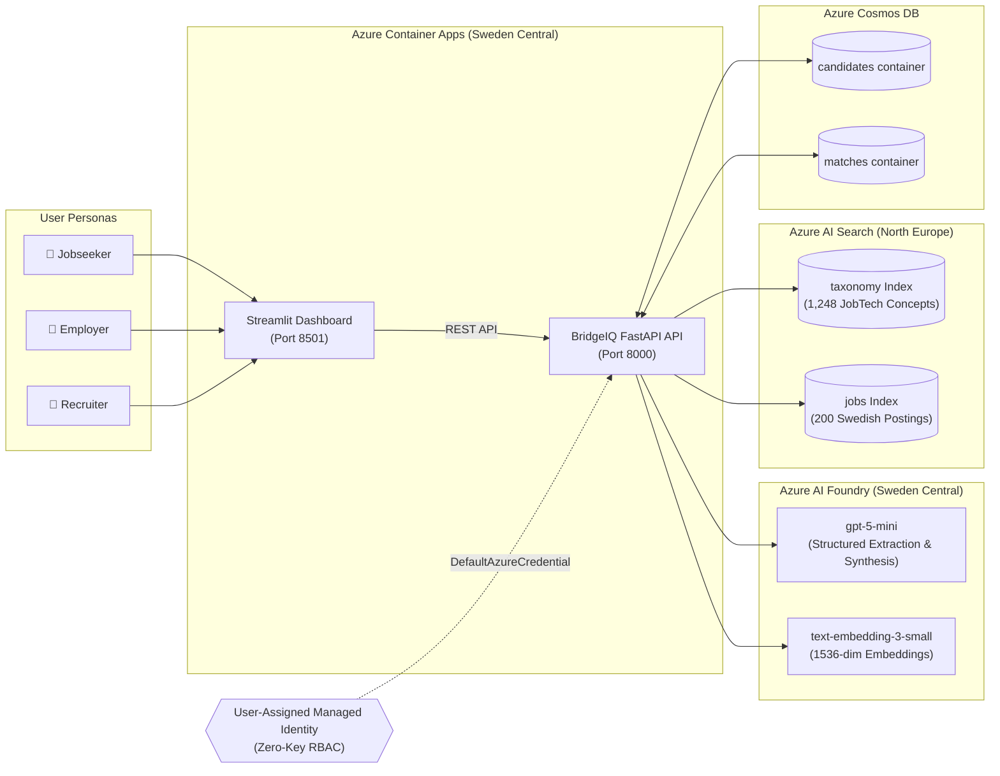

# 💎 BridgeIQ — Hidden Talent Intelligence Box

> **AISpire Hackathon (Accenture · Microsoft)**  
> **Challenge:** Bridging the gap between hidden international/cross-domain talent and Swedish employers.  
> **Live Deployment:** [BridgeIQ on Azure Container Apps](https://aispire-t04-smoke.icyglacier-c95b0396.swedencentral.azurecontainerapps.io)  
> **Region:** Sweden Central / North Europe (Strict EU Data Zone)

---

## 🚀 Latest Release: v0.3.0-rc1 (Claude Prototype Employer Screen & Multi-Dimensional Selection Engine)

- **Claude Prototype-Inspired 3-Column Employer Decision Screen**: Full implementation of the 3-column talent radar layout (`Your Open Roles` -> `Ranked Candidate Pool & Hidden Gem Filter` -> `Deep-Dive Quantitative Decision & Evidence Center`).
- **Multi-Dimensional Quantitative Representation**: Replaced black-box AI scores with auditable, colored metric progress bars and deterministic mathematical formula display:
  - *Competence Coverage* ($Cov$, Teal `#0B6B63`): Share of required JobTech taxonomy concepts grounded in CV.
  - *Semantic Fit* ($Sem$, Blue `#3C7DD9`): Vector cosine similarity.
  - *Title Similarity* ($TSim$, Amber `#B76E00`): Inverted transfer metric highlighting cross-domain hidden gems.
  - *Deterministic Formula*: $S_{\text{comp}} = 0.6 \times Cov + 0.4 \times Sem$.
- **Actionable Candidate Selection & Shortlisting Workflow**: Interactive shortlist button with persistent session tracking (`st.session_state["employer_shortlist"]`), dual-quote verifiable evidence chains, gap-bridging ramp-up effort badges (`days`/`weeks`/`months`), and side-by-side Traditional ATS vs. BridgeIQ comparison matrix.
- **Flagship Pitch Demonstration Center**: 3 strategic archetypes (Amara the Global Hidden Gem, Marcus the Volunteer Pivot, Samira the Self-Taught Dev) with automated judge talking points and 100 Cosmos DB candidate profiles.

---

## 📌 The Problem: The "No One Translates" Paradox

Sweden faces a severe structural talent paradox:
- **73% of Swedish companies** face talent shortages in critical technical domains (telecom, industrial IoT, embedded systems, cleantech).
- **58% of qualified international and career-pivoting applicants** are rejected by traditional keyword-based Applicant Tracking Systems (ATS) due to mismatched past titles or non-standard CV phrasing.
- **The Core Barrier**: *No one translates.* International professionals possess deep transferable capabilities (e.g., maintaining 99.999% uptime on carrier packet cores) that directly solve local shortages (e.g., industrial IoT platform reliability), but rigid title filters block them.

---

## 💡 The BridgeIQ Solution

BridgeIQ is an explainable **Talent Intelligence Box** that acts as an objective translator:
1. **Extracts & Grounds**: Normalizes unstructured English CV text into Sweden's official **JobTech Taxonomy** (1,248 standardized competence concepts), preventing LLM hallucinations.
2. **Title-Agnostic Hybrid Retrieval**: Evaluates candidates based strictly on competence graphs rather than historical job titles using **Azure AI Search (Dense Vectors + BM25)**.
3. **Deterministic Scoring**: Transparent, code-driven scoring formula where LLMs explain but **never decide rankings**.
4. **Bidirectional Explainability**:
   - **For Employers**: Verifiable evidence chains with machine-checked verbatim quotes linking CV statements directly to Job Description requirements.
   - **For Jobseekers**: Constructive gap-bridging strategies with clear, low-barrier learning roadmaps (e.g., a 2-day course on EU NIS2 directives).
   - **For Recruiters**: 3 targeted, structured interview probes (Technical, Situational, Gap) to evaluate transferable competencies.

---

## ☁️ Architecture & Topology



---

## 🛠️ Project Structure

```text
bridgeiq/
├── .github/workflows/
│   └── ci-cd.yml             # GitHub Actions CI/CD (Test + Docker build & push to GHCR)
├── app/
│   ├── main.py               # FastAPI backend with /healthz & /api/v1 routes
│   ├── config.py             # Pydantic Settings & environment config
│   ├── models.py             # Pydantic v2 data contracts (Taxonomy, Matching, Rationale)
│   ├── guardrails/
│   │   ├── pii.py            # Swedish Personnummer & PII scrubber
│   │   └── verify.py         # Verbatim quote substring checker
│   └── pipeline/
│       └── score.py          # Deterministic coverage, semantic, and Hidden Gem scoring
├── ui/
│   └── streamlit_app.py      # Glassmorphic multi-perspective dashboard (Jobseeker/Employer/Recruiter)
├── tests/
│   ├── test_score.py         # Unit tests for scoring & Hidden Gem badge rules
│   ├── test_pii.py           # Unit tests for PII detection & redaction
│   └── test_verify.py        # Unit tests for quote claim verification
├── Docs/                     # Strategic briefs, brainstorms, and implementation plan
├── Dockerfile                # Multi-stage production container running FastAPI + Streamlit
├── pyproject.toml            # Python packaging & dependencies
└── start.sh                  # Container entrypoint starting API & UI services
```

---

## 🏃 Quickstart & Development

### 1. Local Environment Setup
```bash
# Clone the repository
git clone https://github.com/icapsule/bridgeiq-hackathon.git
cd bridgeiq-hackathon

# Create and activate virtual environment
python3.11 -m venv .venv
source .venv/bin/activate

# Install dependencies with development tools
pip install -e .[dev]
```

### 2. Run Tests & Verification
```bash
# Run test suite
pytest tests/ -v

# Run lint checks
ruff check .
```

### 3. Run Locally
```bash
# Run via start script (starts API on 8000 and Streamlit on 8501)
./start.sh
```

---

## 🛡️ Responsible AI & Ethical Principles

- **Human in the Loop**: BridgeIQ suggests, explains, and translates; it never automates hiring rejection.
- **De-biased Retrieval**: Past job titles, candidate age, nationality, and gender are explicitly stripped before semantic search.
- **Machine-Verified Truth**: All claim-to-evidence links are programmatically checked against source texts before rendering to eliminate hallucinations.
- **EU AI Act Ready**: Aligned with High-Risk AI recruitment requirements under Annex III regarding transparency, audit trails, and human oversight.

---

## 🗺️ Product Roadmap & UI/UX Evolution

While the core AI pipeline, Azure search indices, deterministic scoring engine, and 3-column decision cockpit are production-ready in v0.3.0, we have architected a phased UI/UX evolution strategy based on **AgentCore Platform UI Design Systems**:

### 🎯 Path A: High-Fidelity Embedded Visual Engine (Zero-Infra Polish)
To maximize hackathon agility and stability without altering Azure Container Apps deployment topography or CI/CD pipelines, we are incrementally adopting **Path A (Streamlit + Embedded Canvas/SVG Components)**:

- **🕸️ Force-Directed Competency Bridge Graph**:
  - Interactive D3/Canvas node-link diagram mapping candidate source skills (e.g., *Carrier Core Network Hardening*) through Swedish JobTech Taxonomy hubs (*Nätverkssäkerhet*) to target employer requirements.
  - Dynamically demonstrates *how* cross-domain capabilities bridge into industrial vacancies.
- **📊 Multi-Dimensional Competency Radar with ATS Blindspot Overlay**:
  - Interactive dual-layer radar chart juxtaposing traditional ATS keyword collapse (15% match due to title mismatches) against BridgeIQ's true competence overlap (82%), providing immediate narrative clarity for hiring managers.
- **🔍 Zero-Hallucination Evidence Drawer**:
  - Slide-out contextual inspector lens highlighting verbatim CV sentences and JobTech definitions with instant confidence badges and verified groundings.
- **🧭 Interactive Judge Presentation Stepper**:
  - 1-click pitch navigation bar guiding evaluators through the 5-stage transformation lifecycle: *ATS Blindspot $\rightarrow$ PII Scrubbing $\rightarrow$ Taxonomy Grounding $\rightarrow$ Hidden Gem Match $\rightarrow$ Interview Probes*.

> *Note: Path A maintains zero backend friction, allowing continuous, surgical UI polishing while keeping the Azure production container stable and responsive.*

---

## 👥 Team 04 (AISpire Hackathon 2026)
Built with ❤️ by Team 04 for Accenture · Microsoft AISpire Hackathon.

